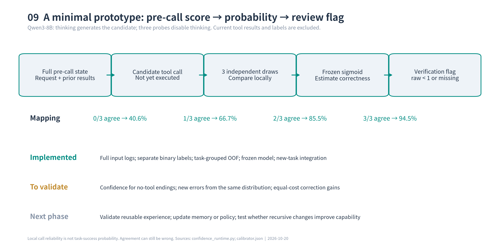
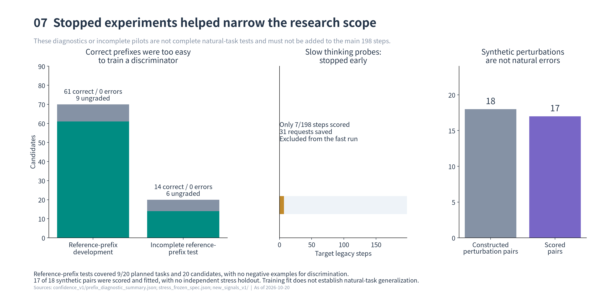
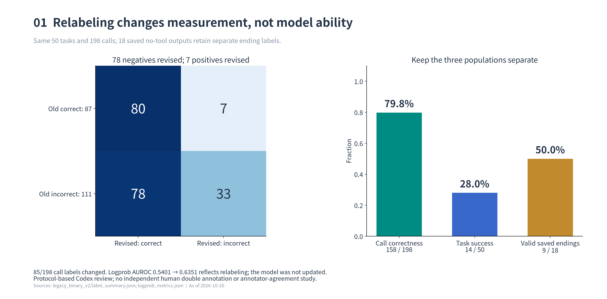
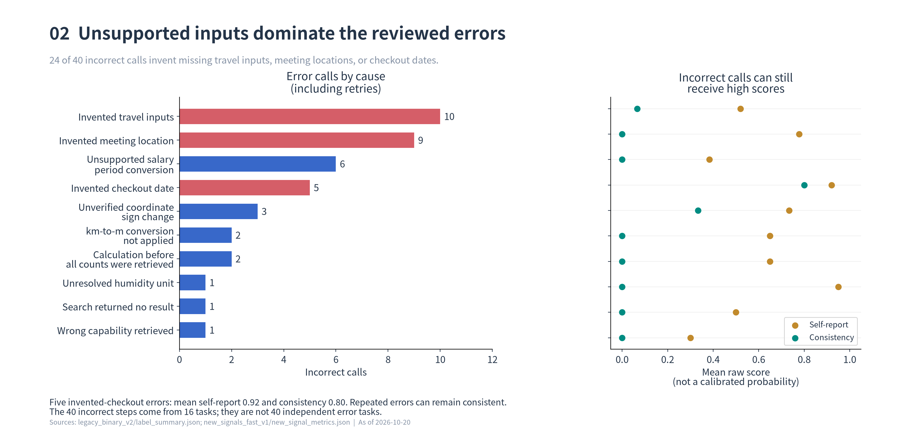
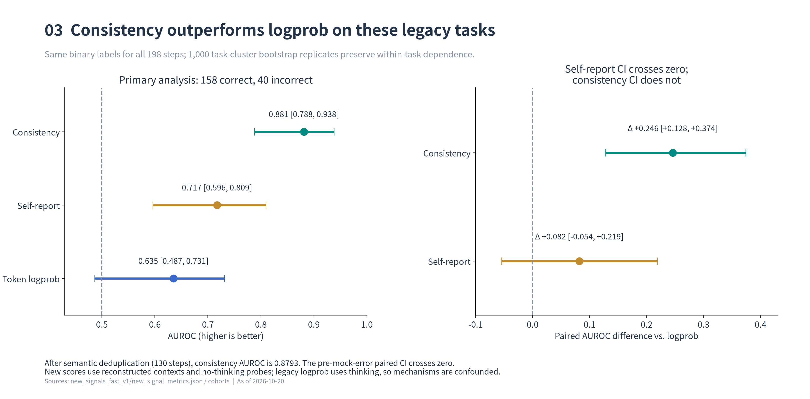
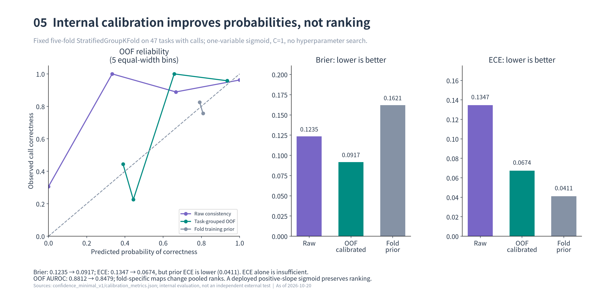
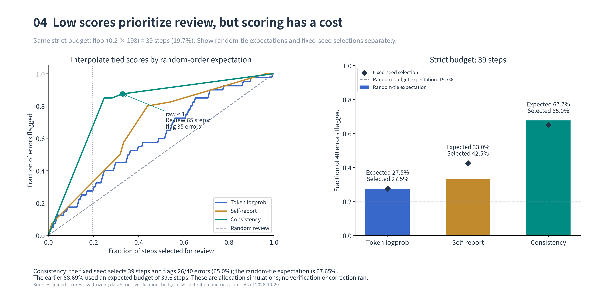
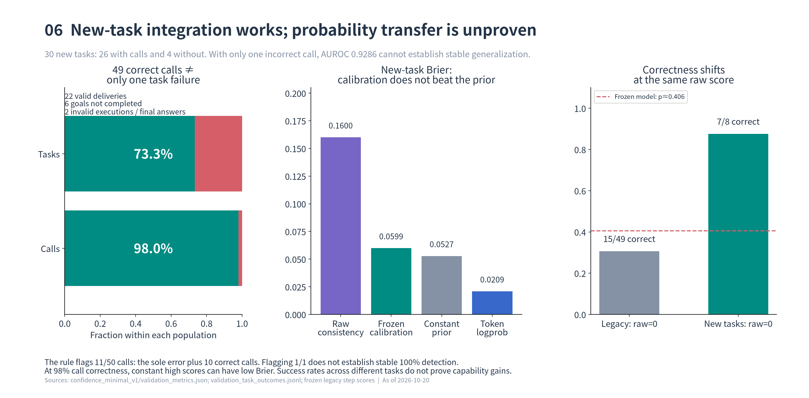
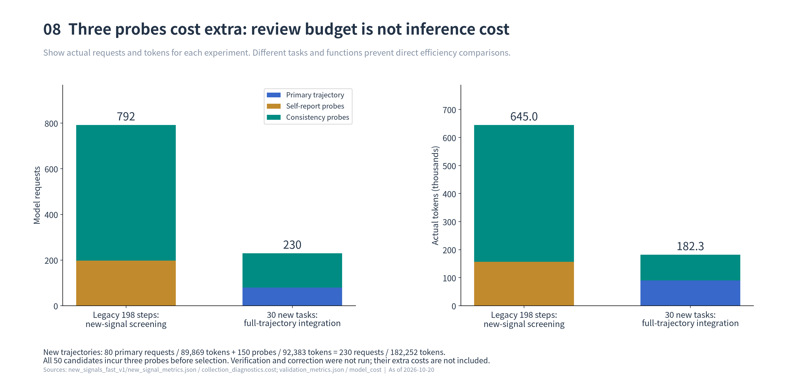

# ConfAgent 中期研究报告：从标签审计到步骤置信度的最小实现

日期：2026-10-20

## 摘要

本项目研究如何利用步骤级置信度发现工具智能体执行中的薄弱环节，并进一步驱动验证、纠错和经验更新。目前已完成工具调用步骤的最小评分接口：给定调用前上下文与候选动作，通过三次独立采样计算一致性，再映射为调用正确概率，并输出验证建议。尚未实证自主纠错或递归改进带来的任务收益。

核心证据分为两批数据。第一批是反复复用的 API-Bank 旧 50 个任务、198 次调用：完成标签清洗后得到 158 正、40 负；一致性 AUROC 为 0.8812，按任务分组的折外校准使 Brier 从 0.1235 降至 0.0917。第二批为冻结接口后的 30 个新任务、50 次调用：49 正、1 负，任务完成 22/30；负例不足，且校准概率的 Brier 未胜过旧训练集常数先验，因此跨任务概率泛化仍未解决。

这些结果支持“已有一个可调用、可追溯的步骤置信度模块”，不支持“已证明递归自我改进有效”。

## 一、研究问题与统计口径

研究链条是：估计当前步骤可靠性，选择需要验证的位置，执行补充信息或纠错，再筛选经验供后续任务使用。本阶段集中回答前两项中的评分与验证选择问题。排序指标 AUROC 回答“低分是否更容易出错”；Brier、ECE、NLL 回答“分数能否解释为正确概率”；错误捕获率回答“有限检查预算能覆盖多少错误”。三者不能相互替代。

本报告严格区分三种单位：**调用正确性、结束事件正确性、任务完成情况**。调用正确要求 API、参数、单位和前置证据合理；未提供的信息被擅自补出，也属于错误。前面调用均合理，却遗漏目标或提前结束，仍是失败任务，但不能把此前每个调用都改成错误。有限 mock 对合理调用的拒绝，需要记录为环境问题，不能直接等同于模型调用错误。

所有标签均保留原值和修订依据。复核由 Codex 及子 agent 按固定协议对照需求、工具文档和可见历史完成，审查时隔离置信度分数；**没有独立人工双标或人工标注一致性统计**。

主要实验使用 **Qwen3-8B**。旧、新主轨迹均由任务参考记录构建相关 API 集并预先提供给模型，工具返回来自有限响应 mock；这是给定相关工具的多步编排，不是全库 API 发现，也没有调用真实外部服务。新主轨迹开启思考、temperature=0、每次生成最多 2048 token、每任务最多 8 次调用；一致性补采关闭思考，K=3、temperature=0.7、top_p=1、最多 4096 token。5 次新任务生成截断发生在该生成预算下，尚未测试扩大预算能否改善；不能直接视为模型在任意预算下都无法完成。

## 二、实际完成的实验链条

| 阶段 | 数据与操作 | 结果与解释 |
|---|---|---|
| 原始自由执行基线 | 50 任务、198 次调用，记录推理 token logprob | 旧标签为 87 正、111 负；任务成功 13/50，暴露循环与提前结束 |
| 参考前缀诊断 | 用参考历史提供较干净的前置状态，划分开发与内部测试任务 | 开发已判定样本全部正确，无法训练判别器；测试未采完即停止 |
| 三元标签审计 v1 | 原 198 步，分正确／错误／无法确定 | 156／4／38；口径过度排除缺信息行为，现已被二元 v2 替代 |
| 二元标签修订 v2 | 同一 198 步全量重新核查，补充结束与任务结果 | 调用 158／40，任务完成 14/50，作为后续固定标签 |
| 保留思考的一致性试跑 | 在旧步骤上额外询问和采样 | 仅汇总 7/198 步、31 次请求尝试，因成本早停，未并入正式结果 |
| fast 新信号初筛 | 同一 198 步，关闭思考，补采自陈和 K=3 一致性 | 一致性优于原 logprob；仍属历史数据上的探索性筛选 |
| 按任务 OOF 校准 | 同一 198 步、47 个有调用任务，固定五折 | 得到内部折外概率评估，随后用全量旧数据冻结部署参数 |
| 新任务接口验证 | 冻结后执行 30 个不同需求任务，50 次调用 | 49／1，任务完成 22/30；验证接口贯通，泛化证据不足 |

旧数据的标签、信号和校准分析是**同一批 198 步的连续开发工作**，不是多个独立验证集。早期参考前缀分割中的任务也曾被查看，不应称为完全未接触的 holdout。[原轨迹](../results/traj_main_clean.jsonl)、[前缀汇总](../outputs/confidence_v1/prefix_diagnostic_summary.json)、[思考模式试跑说明](../outputs/new_signals_v1/试运行说明.md)提供各阶段来源。

更早的运行原型也已纳入[完整实验账本](data/experiment_ledger.csv)：`traj_vanilla` 为 5 任务、48 次调用，`traj_pilot` 为 8 任务、20 次调用，均与后续主任务重叠，使用旧标注口径，不作为当前有效对照；`traj_main_seed0` 含 67 条记录、50 个唯一任务和 261 次调用，是去重前的中间文件。正式主分析使用 `traj_main_clean` 的 50 任务、198 次调用，不把上述文件相加。未经独立指标文件核验的早期 pilot AUROC 也不画成正式效果图。

前缀开发集有 70 个候选，61 个已判定正确、0 个错误、9 个未判定；内部测试计划 20 个任务，只观察到 9 个任务的 20 个候选，其中 14 正确、6 未判定。没有负例，最终只保留常数方案，并未得到有效判别校准器。这说明参考历史降低了困难，不能据此推断自由执行可靠。另构造 18 对单参数扰动的合成压力样本，其中 17 对完成评分，仅做训练侧诊断，没有独立测试；其目标分布不是自然错误，不计入自然任务性能。[冻结诊断记录](../outputs/confidence_v1/frozen_model_spec.json)、[合成压力协议](../outputs/confidence_v1/stress_frozen_spec.json)。

## 三、标签清洗改变了什么

原基线平均每任务 3.96 次调用，范围 0–12，总 token 为 156,147；停止原因为 success 13、final_answer 18、repeated_call 18、max_steps 1。旧 111 个负例大量混入数值字符串、错误参考公式等环境误判，因此不能当作 111 次真实模型错误。

v1 三元审计只留下 4 个明确错误、排除 38 步，导致“160 个可判定样本”的结果，其 logprob AUROC 为 0.3718。样本排除与负例过少限制了解释。随后按二元目标明确：缺少依据仍编造地点、日期或旅行参数，应判错误；不能因为隐藏参考也不完整就排除。v1 是历史中间结果，不再作为主结论。[v1 历史报告](../outputs/legacy_relabel_v1/修订标签与logprob评估.md)。

v2 全量结果为 158 正、40 负。78 个旧负例改为正确，7 个旧正例改为错误。前者包括 64 次数值表示差异、11 次有依据的求和、3 次地址末尾句点；后者主要涉及无依据参数与单位问题。

| 真实调用错误类型 | 次数 |
|---|---:|
| 编造旅行参数／会议地点／退房日期 | 10／9／5 |
| 无依据改变工资周期 | 6 |
| 未核验就改变坐标符号 | 3 |
| 公里未换成米 | 2 |
| 前置信息未齐就求和 | 2 |
| 湿度单位未处理 | 1 |
| 检索无结果／能力不匹配 | 1／1 |
| **合计** | **40** |

例如，需求给出 1 km 而 API 要求米，传入 1 是真实错误；点赞数 70、80、90 已可见，计算 240 虽被错误参考拒绝，调用仍正确；尚未查到第三个点赞数便写出 10+20+30，则是缺少依据的过程错误，即使后来数值碰巧相同。

另补标 18 次原始无工具结束输出，9 完成、9 未完成；这些事件未保存原生 logprob，不填零、不复用上一调用分数。其余 32 次为运行器停止，不能伪装成模型主动终止。全任务复核为 14 完成、36 未完成；从原 13/50 到 14/50 也是判定修订，并非新能力。[二元主报告](../outputs/legacy_binary_v2/二元标签与logprob评估.md)。

## 四、新信号有没有区分价值

清洗后原 logprob 的 AUROC 从旧标签下的 0.5401 变成 0.6351；动作和分数完全未变，**这是改标签后的重评，不是模型提升**。之后才额外请求模型，比较自陈和多采样一致性。

自陈是在给定需求、工具、此前历史及原候选后询问正确概率。主一致性是在相同调用前状态独立采样 3 次，计算与原候选动作等价的比例；它不是新样本内部的多数派占比。语义匹配规范化数值、时间与安全算术，主指标排除提醒内容的自由措辞，严格全字段结果另报。

| 信号 | AUROC | 按任务 bootstrap 95% CI | 最低分 20% 错误捕获率 |
|---|---:|---|---:|
| 原 logprob | 0.6351 | [0.487, 0.731] | 29.0% |
| 自陈置信度 | 0.7172 | [0.596, 0.809] | 33.4% |
| 多采样一致性 | **0.8812** | **[0.788, 0.938]** | **68.7%** |

一致性相对 logprob 的 AUROC 配对差为 0.2460，95% CI 为 [0.128, 0.374]；自陈差为 0.0820，区间 [-0.054, 0.219]，提升尚不确定。重试去重后，一致性 AUROC 仍为 0.8793。以上区间按任务重采样 1000 次，避免将同任务步骤当独立样本。表中捕获率沿用初筛报告：20% 对应 39.6 步的期望预算，同分采用随机顺序期望；实际只能检查整数步，下一节另报严格预算。[新信号报告](../outputs/new_signals_fast_v1/新信号评估.md)。

原日志没有完整逐步输入，新增信号来自重建状态；fast 采样关闭思考，原动作则来自旧思考策略。因此是“重建状态下的自评和一致性”初筛，不能把差异全部归因于信号机制。此前 mock 错误反馈仍在历史中，多个合理动作会拉低一致性，稳定重复同一错误也会给高分。

## 五、从一致性到正确概率

选择一致性后，固定使用单变量逻辑回归、C=1、五折 StratifiedGroupKFold，按 task_id 分组。同一任务不能同时出现在一折的训练和验证中；每个旧步骤的 OOF 概率均由其他任务拟合。未搜索特征、超参数或最优验证阈值。

| 旧开发数据方法 | AUROC | Brier ↓ | ECE：5 箱 ↓ | NLL ↓ |
|---|---:|---:|---:|---:|
| 原始一致性 | 0.8812 | 0.1235 | 0.1347 | 1.4563 |
| 按任务 OOF 校准 | 0.8479 | **0.0917** | 0.0674 | **0.3094** |
| 训练折常数先验 | 0.4359 | 0.1621 | **0.0411** | 0.5061 |

校准改善的是概率刻度。单个正向 sigmoid 保持排序；OOF 由五个不同映射给分，总体 AUROC 可以变化。常数基线的 ECE 更低，说明小样本分箱指标不能单独决定优劣；原始 0/1 分数的 NLL 按 1e-6 截断，也应结合 Brier 理解。

固定规则 `raw_consistency < 1` 选中 65/198 步，覆盖 35/40 个错误，即检查 32.8% 步骤、捕获 87.5% 错误。严格整数 20% 预算选择 39 步，固定同分种子下捕获 26/40，即 65.0%；由[冻结逐步分数](../outputs/new_signals_fast_v1/scores.jsonl)按同样 39 步预算重算，同分随机期望为 67.65%。三种信号统一预算的重算结果保存在[严格预算表](data/strict_verification_budget.csv)，固定选择沿用原校准脚本的 NumPy 随机算法与输入顺序。它们与前节 39.6 步预算的 68.7% 属于不同口径。这里只模拟验证位置，没有执行纠错。[校准报告](../outputs/confidence_minimal_v1/一致性校准报告.md)。

最终用全部旧步骤冻结 `p_correct = sigmoid(-0.381115 + 3.233718 × consistency)`。接口输出原始一致性、正确概率、验证建议及原因；缺失采样保持 null 并要求验证。三次全一致映射约 94.5%，不是正确保证。OOF 控制任务内泄漏，但不能消除先在同一批任务上选择信号的偏差。

## 六、冻结后的新任务验证

新任务来自 API-Bank 的 `training-data/lv3-response-train.json`，在 61 个可解析且 schema 完整的候选中预选；与原需求没有文本完全重复，但没有严格按语义或工具族留出。模型请求前确定任务及顺序，不能称作 API-Bank 官方测试分割。协议先跑 20 个任务，若调用错误不足 10 个则逐个追加，最多 30 个；最终达到上限。因为样本量规则依赖错误数量，不能描述成固定规模的标准测试。工具在有限响应 mock 中执行，验证建议暂不改变动作。

实际 30 个任务中，26 个产生调用，4 个没有调用；50 次调用复核为 49 正、1 负。唯一真实错误是编造未提供的临床试验 ID。另一个自动负例因有依据的完整日期时间被 mock 误拒绝，改为局部调用正确；原标签保留。

| 新任务同样本指标 | AUROC | Brier ↓ | ECE：10 箱 ↓ |
|---|---:|---:|---:|
| 原始一致性 | 0.9286 | 0.160000 | 0.1733 |
| 冻结校准概率 | 0.9286 | 0.059879 | 0.1338 |
| 旧训练集常数先验 | 0.5000 | 0.052731 | 0.1820 |
| 本轮 logprob | 0.8571 | **0.0209** | 0.0437 |

**只有 1 个负例，高 AUROC 和捕获唯一错误不能证明稳定泛化。** 校准优于直接将一致性当概率，但 Brier 高于常数先验，也高于本轮 logprob，尚不能声称跨域校准成功。本批调用 98% 正确，恒高概率也容易取得较低 Brier；不能据此认定 logprob 已解决跨任务可靠性判断。新旧标签先验、任务工具族及环境均不同，ECE 分箱也不同，不能机械横比。

独立统计任务及结束结果为 22 个目标完成且交付合格、8 个失败。后者中 6 个核心目标未完成，包括生成截断 5、有限 mock 无匹配响应 1；另 2 个虽已完成核心目标，但有编造额外调用并误述来源、终答擅自断言费用周期等执行或交付错误。可见 98% 调用正确率不等于 98% 任务成功率。22/30 与旧 14/50 的任务构成及执行设置不同，不能作为能力提升对照。

固定规则选中 11/50 步，包含唯一错误，同时误报 10 个正确步骤。结束步骤尚无专门置信度模型，不能用调用分数替代。[新任务报告](../outputs/confidence_minimal_v1/新任务验证报告.md)、[任务与结束标签](../outputs/confidence_minimal_v1/validation_task_outcomes.jsonl)。

## 七、开销、研究状态与下一步

旧步骤 fast 初筛增加 792 次请求、645,011 token，其中 594 次为动作补采。新任务验证共 230 次请求：主轨迹 80 次、置信度补采 150 次；总 token 为 182,252，其中补采 92,383。一次工具评分额外需要三次模型请求，选中多少步骤验证不等于全部推理成本。校准拟合和指标复算使用 CPU，不需要新的模型调用。

当前已完成标签审计、候选信号比较、内部概率校准、可复用接口和一批新任务集成验证。未完成的关键环节有三个：跨任务校准的稳定证据；最终回答、无工具结束等终止事件的置信度；验证、纠错及经验更新的因果收益。不能将规则输出 `needs_verification` 描述成已经验证或修复。

下一步应先冻结当前协议，在明确成本上限下积累更多自然错误与结束事件；工具族、任务和重试需分组评估。随后把低一致性建议接到一个简单、可执行的检查动作，例如核对参数依据或单位，再与相同任务、相同预算的无验证基线对照。只有确认纠错提高实际完成率、并计入额外 token 和请求后，才进入经验筛选与跨轮复用实验。合成错误可用于调试，但必须与自然任务结果单列。

本阶段最可靠的贡献是建立了从可靠标签、候选信号、概率映射到调用前验证建议的完整可追溯链条；对自主纠错和递归改进，结论仍待实验。

## 主要结果来源

| 内容 | 来源 |
|---|---|
| 二元调用、结束与任务标签 | [`legacy_binary_v2`](../outputs/legacy_binary_v2/二元标签与logprob评估.md) |
| 自陈／一致性、配对区间与成本 | [`new_signals_fast_v1`](../outputs/new_signals_fast_v1/新信号评估.md) |
| 按任务 OOF 与冻结参数 | [`confidence_minimal_v1/一致性校准报告.md`](../outputs/confidence_minimal_v1/一致性校准报告.md) |
| 新任务、失败类型与成本 | [`confidence_minimal_v1/新任务验证报告.md`](../outputs/confidence_minimal_v1/新任务验证报告.md) |
| 评分接口和使用范围 | [`README_step_confidence.md`](../code/README_step_confidence.md) |
