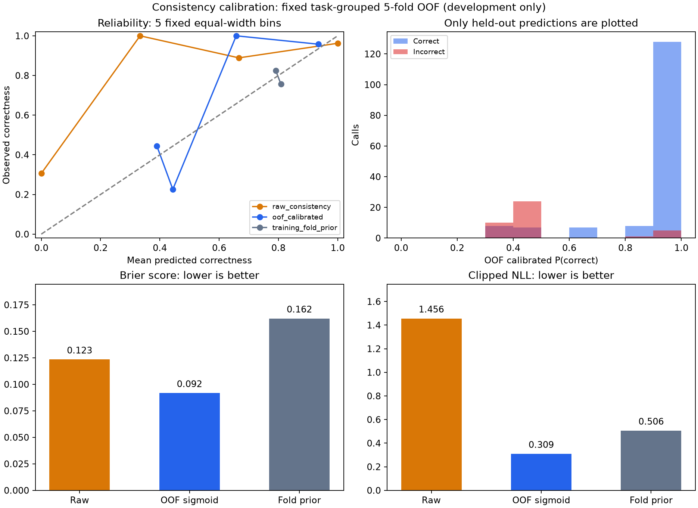

# 最小交付：步骤一致性的概率校准

复用清洗后的 198 次旧工具调用（158 正确、40 错误；47 个有调用的任务），只使用 fast 模式多采样一致性一个信号。本脚本只做 CPU 统计和拟合，没有调用模型、执行工具或读取后续新验证任务。

将原始一致性映射为当前调用正确的概率：`p_correct = sigmoid(intercept + coefficient × consistency)`。原始输入不标准化，LogisticRegression 固定 C=1，不调参。

以下全部是固定 5 折 StratifiedGroupKFold 的 OOF 结果，按 task_id 分组、固定种子 20261019。同一任务全部步骤只在一折中验证；其概率由其他任务训练得到。训练折先验常数也只用该训练折标签。没有把全量拟合后的训练成绩当泛化成绩。

| 方法 | AUROC | Brier ↓ | ECE（5 等宽箱）↓ | NLL ↓ |
| --- | ---: | ---: | ---: | ---: |
| 原始一致性 | 0.8812 | 0.1235 | 0.1347 | 1.4563 |
| 任务分组 OOF 校准 | 0.8479 | 0.0917 | 0.0674 | 0.3094 |
| 训练折先验常数 | 0.4359 | 0.1621 | 0.0411 | 0.5061 |

Brier/NLL 衡量概率质量，ECE 依赖这批小样本和分箱。原始 0/1 一致性在 NLL 中按 ε=1e-6 截断，因此原始分数的极端错误会产生较大 NLL；Brier 和 ECE 不做截断。单个正向 sigmoid 保持原始排序，校准主要调整概率刻度；OOF 由不同折模型给分，其总体 AUROC 可有变化。

| 折 | 训练正确/错误 | 验证正确/错误 | 训练/验证任务数 | 斜率 | 状态 |
| ---: | ---: | ---: | ---: | ---: | --- |
| 0 | 122/33 | 36/7 | 38/9 | 3.0541 | positive_slope |
| 1 | 128/32 | 30/8 | 37/10 | 2.9216 | positive_slope |
| 2 | 126/33 | 32/7 | 38/9 | 3.1729 | positive_slope |
| 3 | 129/29 | 29/11 | 37/10 | 2.8420 | positive_slope |
| 4 | 127/33 | 31/7 | 38/9 | 3.5015 | positive_slope |

非正斜率训练折数：0。预先固定规则为：拟合斜率 ≤0 时记录原始斜率，退回该训练折先验概率（coefficient=0），不翻转信号方向。

验证触发规则预先固定为 **raw consistency < 1**；运行时若一致性因传输失败缺失，概率保持 null，要求验证。没有在错误类型或全体标签上搜索最优阈值。下表仅模拟选择哪些步骤进一步验证，尚未证明验证能纠错。

| 选择规则 | 验证步数 | 验证比例 | 捕获错误/全部错误 | 错误捕获率 | 验证中错误比例 |
| --- | ---: | ---: | ---: | ---: | ---: |
| raw consistency < 1 | 65 | 32.8% | 35/40 | 87.5% | 53.8% |
| 最低分 20%：原始一致性 | 39 | 19.7% | 26/40 | 65.0% | 66.7% |
| 最低分 20%：任务分组 OOF 校准 | 39 | 19.7% | 26/40 | 65.0% | 66.7% |
| 最低分 20%：训练折先验常数 | 39 | 19.7% | 7/40 | 17.5% | 17.9% |

20% 预算向下取整到整数步数；同分按固定种子随机顺序选取，每次重跑结果相同。这与此前按同分随机期望计算的分数诊断不同，JSON/CSV 给出实际选中的步骤。

最终部署参数由全部旧开发步骤拟合一次并冻结到 calibrator.json：intercept=-0.381115，coefficient=3.233718，状态 positive_slope。这份全量模型供后续新任务使用，其训练集预测不列为评估成绩。JSON 无 pickle 依赖，可用标准 sigmoid 读取。

一致性来自重建前置状态下的无思考采样策略（K=3，temperature=0.7），旧标签和任务已被审阅，该信号也曾根据这批任务的比较结果筛选；OOF 不消除信号选择偏差，仍是历史任务的内部开发诊断，并非新的独立测试。旧模拟器错误反馈、任务族相似、仅四档一致性和重复调用都限制泛化解释。后续必须在新的真实执行步骤上独立检验。



- calibrator.json：固定输入协议、正向 sigmoid 参数、验证规则和输入哈希。
- oof_predictions.jsonl / .csv：逐步 OOF 概率、训练折先验、折号、固定验证选择。
- calibration_metrics.json：三方法指标、可靠性分箱、每折训练/验证任务和参数、验证覆盖/捕错。

在项目根目录复现，只运行 CPU：

```bash
python code/calibrate_consistency.py --labels outputs/legacy_binary_v2/calls_binary.jsonl --scores outputs/new_signals_fast_v1/scores.jsonl --out-dir outputs/confidence_minimal_v1
```
