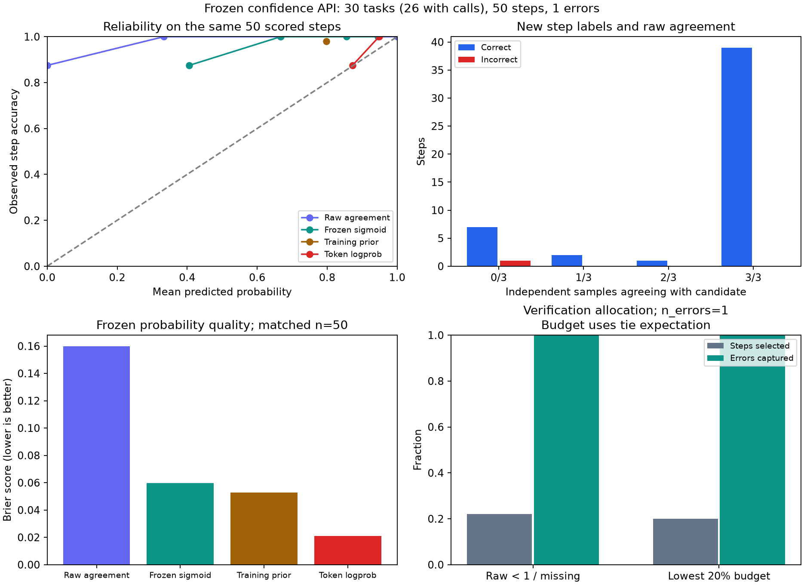

# 新任务上的冻结置信度接口验证

本报告包含 26 个有工具调用的任务、50 次工具调用：49 正确、1 错误，步骤正确率 0.9800。

校准器在采集新任务之前冻结；本脚本只连接分数与二元标签、计算指标，不重新拟合，也不调用模型或执行工具。这是新任务上的集成验证，不能解释为大规模独立泛化证明。

任务来源：`data/api-bank/training-data/lv3-response-train.json`。与此前 level-3 需求的完全重叠数为 0。

预先冻结的样本量约定：先跑 20 个任务；若调用错误不足 10 个，按预选顺序逐个追加任务，达到 10 个错误即停，最多 30 个。触发条件涉及错误数量，因此不能当作固定样本量的大规模测试；不按 AUROC 挑选或剔除任务。

实际已执行 30 个任务，其中 4 个没有工具调用；26 个任务贡献本报告的工具步骤。这些数量不是任务成功率。

## 独立的任务完成与结束标签

按屏蔽分数的审查资料复核全部 30 个任务：**22 任务成功／交付合格、8 任务失败**，任务成功率 0.7333。结束结果标签另计 22 正确、8 错误。

这组任务／结束结果与 50 次工具调用的 49 正、1 负分开统计，不能混成同一准确率。失败包括目标已完成但额外执行或终答出错的情况，不能全称为核心目标未完成。本轮使用不同任务，不能与此前旧 50 个任务的成功率直接比较或据此声称能力提升。

| 任务失败原因 | 次数 |
| --- | ---: |
| 生成截断，未完成任务（`generation_truncated`） | 5 |
| 编造额外调用参数，并误述信息来源（`unsupported_final_claim_and_unrequested_fabricated_call`） | 1 |
| 有限 mock 无匹配响应，任务未实际执行成功（`finite_mock_no_recorded_response`） | 1 |
| 费用周期的断言缺少依据（`unsupported_cost_period_claim`） | 1 |

零工具调用任务没有可评价的工具步骤，不进入上述步级指标；任务完成率也不与步骤正确率混用。

## 1. 各信号的覆盖与指标

各行先报告自身可用样本；缺失值不补 0。AUROC 越大越好，Brier、ECE、NLL 越小越好。ECE 使用 10 个等宽区间，NLL 仅为避免 log(0) 将概率截到 [1e-12, 1-1e-12]。

| 信号 | 可用 / 全部 | 正 / 负 | AUROC | Brier | ECE | NLL |
| --- | ---: | ---: | ---: | ---: | ---: | ---: |
| 原始一致性 | 50 / 50 | 49 / 1 | 0.9286 | 0.1600 | 0.1733 | 3.9204 |
| 冻结校准概率 | 50 / 50 | 49 / 1 | 0.9286 | 0.0599 | 0.1338 | 0.1997 |
| 训练集常数先验 | 50 / 50 | 49 / 1 | 0.5000 | 0.0527 | 0.1820 | 0.2531 |
| 原 logprob | 50 / 50 | 49 / 1 | 0.8571 | 0.0209 | 0.0437 | 0.1089 |

### 一致性与校准概率、常数先验的同样本比较

共 50 步（49 正、1 负）。

| 信号 | AUROC | Brier | ECE | NLL |
| --- | ---: | ---: | ---: | ---: |
| 原始一致性 | 0.9286 | 0.1600 | 0.1733 | 3.9204 |
| 冻结校准概率 | 0.9286 | 0.0599 | 0.1338 | 0.1997 |
| 训练集常数先验 | 0.5000 | 0.0527 | 0.1820 | 0.2531 |

### 包含 logprob 的四信号同样本比较

共 50 步（49 正、1 负）。

| 信号 | AUROC | Brier | ECE | NLL |
| --- | ---: | ---: | ---: | ---: |
| 原始一致性 | 0.9286 | 0.1600 | 0.1733 | 3.9204 |
| 冻结校准概率 | 0.9286 | 0.0599 | 0.1338 | 0.1997 |
| 训练集常数先验 | 0.5000 | 0.0527 | 0.1820 | 0.2531 |
| 原 logprob | 0.8571 | 0.0209 | 0.0437 | 0.1089 |

**本轮负例仅 1 个，少于 10 个；AUROC 和错误捕获率很不稳定，单个错误就可能显著改变数值。即使捕获率为 100%，也不能据此证明稳定的区分或泛化能力。**

**同样本上，冻结校准概率的 Brier 为 0.0599，高于训练集常数先验的 0.0527。当前结果不能声称新域概率优于常数基线，也不能据此宣称校准泛化成功。**

正斜率 sigmoid 保持原分数排序，因而通常不会提高 AUROC；校准应主要检查概率误差是否下降。常数先验固定取训练 198 步的正确率，不使用新标签估计先验。

## 2. 验证资源分配

冻结规则为 `raw_consistency < 1`；缺失分数也触发验证。选中 11 / 50 步，覆盖率 0.2200；捕获 1 / 1 个错误，错误捕获率 1.0000；选中步骤中的错误占比 0.0909。

最低 20% 采用严格 `floor(0.2 × 可用步数)` 预算，同分按预先固定种子 20261019 打乱，同时报告同分随机抽查的期望。下面各信号统一使用四信号共同可用集；若 logprob 完全缺失，则改用一致性共同可用集。

| 信号 | 预算 / 可用 | 固定种子捕错 | 固定种子捕错率 | 同分随机期望捕错率 |
| --- | ---: | ---: | ---: | ---: |
| 原始一致性 | 10 / 50 | 1 | 1.0000 | 1.0000 |
| 冻结校准概率 | 10 / 50 | 1 | 1.0000 | 1.0000 |
| 训练集常数先验 | 10 / 50 | 0 | 0.0000 | 0.2000 |
| 原 logprob | 10 / 50 | 1 | 1.0000 | 1.0000 |

另按全部步骤分配预算（缺失分数优先），选择 10 / 50 步，同分随机期望捕错率 1.0000。

## 3. 质量与解释边界

缺少一致性分数 0 步，缺少可用 logprob 0 步。采样响应中无工具 10 次、截断 0 次、多工具 0 次；多工具仍沿用旧实验的首个调用规则。

验证任务使用 mock 工具；分数判断的是候选工具调用在当时需求与历史依据下的正确性，不能把所有工具调用正确等同于整个任务已完成。少量任务和同任务内相关步骤会限制结论，需要结合错误类型与采集协议理解结果。

标签审查由 Codex 模型代理在屏蔽分数的资料上完成，不等于独立人工双标。

文件：`validation_steps.jsonl` 保存步骤与调用前上下文及紧凑采样记录，`validation_labels.jsonl` 保存二元标签及依据，`validation_protocol.json` 保存采集约定，`validation_metrics.json` 保存本报告全部数值、覆盖率和预算明细。

公开包以 `collection_summary.json` 保留请求数和 token 汇总，未发布原始请求日志。`publication.json` 区分原始实验文件哈希与本次公开文件的实际哈希；公开离线拟合参数、OOF 预测和指标与原结果相同。

模型采集汇总共 230 次请求；有 usage 记录的总 token 为 182252。各请求类型的明细保存在指标 JSON。
