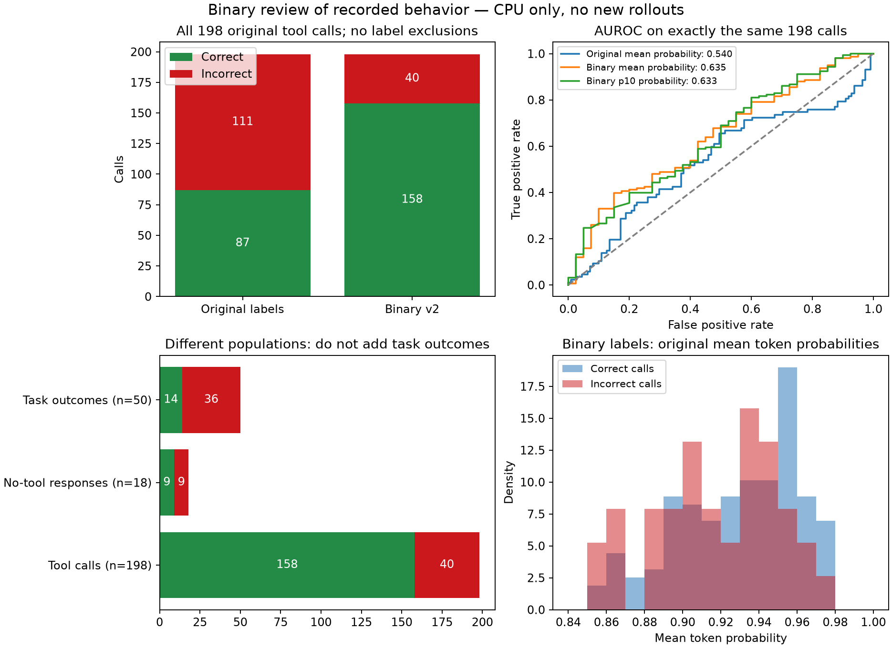

# 二元标签修订与 logprob 评估（v2）

日期：2026-10-15。按用户确认的规则，仅使用 **正确（1）／错误（0）** 两个标签。全部为 CPU 离线处理，模型调用 0 次。原始数据及 v1 审计保留。

**198 次工具调用全部纳入：158 正确、40 错误。** 另补原日志中 18 次无工具输出的任务结束标签：9 正确、9 错误。50 个任务的结束结果为 14 完成、36 未完成。三个统计对象分别报告，不能混成一个准确率。

原有 geo_mean_prob 在这 198 次调用上的 AUROC：旧标签 0.5401 → 二元标签 **0.6351**。按任务 bootstrap 95% 区间为 [0.487, 0.731]。这是已经审阅过的旧轨迹重评，不是独立测试，也没有训练新校准器。

## 1. 固定二元判定规则

- 关键地点、日期、时长没有来源而自行填写：错误。
- 未查询齐所需数据就计算、无依据改变坐标或工资周期：错误。
- API 单位不符或关键单位未经核实就执行：错误。
- 数字与数字字符串、等价算式、地址句号等表示差异不造成语义错误。
- 环境有 schema/参考缺陷时记录原因；同一次调用里其他无依据参数仍判错，不设第三类标签。
- 先前调用正确，最后漏做、未产出必要结果：结束时任务标签为错误；不把先前正确调用一并改错。
- 中间出错后实际完成目标：任务可以正确，不再要求整条历史从未失败。

这是一套可复现的“任务依据与工具协议”评分口径。工资周期、坐标、湿度等旧争议项也按该口径明确给 0/1，原因和环境责任保留在元数据中；不声称它们经过外部独立事实核验。

## 2. 工具调用的错误类型

| 错误类型 | 次数 |
| --- | ---: |
| 湿度单位未核实/转换 | 1 |
| 检索未返回结果 | 1 |
| 编造会议地点 | 9 |
| 公里未转换为米 | 2 |
| 未查齐数据即计算 | 2 |
| 编造退房日期 | 5 |
| 未核验就改变坐标符号 | 3 |
| 无依据改变工资周期 | 6 |
| 编造未提供的出行参数 | 10 |
| 检索能力不匹配 | 1 |

与旧 111 个负标签相比，78 个表示/参考误判仍修为正确；另外 7 个旧正标签因无依据参数、单位等问题改为错误。不是把此前所有争议项机械改为错误：两个有用的工具文档搜索判为正确。

## 3. 漏做和提前结束如何计入

原始 198 步只包含工具调用。另有 18 次模型输出没有工具调用，原运行器直接以 final_answer 结束，其中还包括未闭合思考、未形成正式答案的输出。这些输出逐一补充二元任务结束标签，纳入 `events_binary.csv`，包括零调用任务。

另 32 个结束由运行器触发（success、repeated_call 或 max_steps），只记任务结果，不伪装成模型主动做出的停止决策。结束标签表示目标是否完成；例如任务未完成但提出合理澄清，仍是任务未完成，不把澄清请求本身描述成不合理行为。

例子：l3-000 的查询和已发送提醒仍正确，但遗漏另一场应发送提醒，结束标签错误；l3-014 的预约 API 返回错误，却声称预约成功，结束标签错误。l3-026 两次提前求和调用错误，但后来已查齐数据并给出正确总数 60，任务结束标签正确。

**结束输出的 logprob 未被原日志保存。** 这 18 个事件保留标签，但不能重算其置信度 AUROC；不以 0 或最后一次工具调用分数填充。所以当前调用分数评估覆盖 198/198 调用，覆盖已标注模型事件 198/216；停止质量的置信度评估仍缺原始分数。

## 4. 同一批任务为什么从 13/50 变成 14/50

这是修改完成判定后的重新审计，不是能力提升。判定依据是实际日志中的任务目标是否完成；不会把被模拟器拒绝的正确调用假装成一次实际成功执行。不要求额外的 AccountInfo，也不要求中途从未失败。电影任务要求有排除已看电影的记录，求和任务要求实际计算结果或正确最终总数。

| 任务类别 | 旧通过数 | 本次完成数 |
| --- | ---: | ---: |
| 会议提醒 | 4 | 4 |
| 天气与穿衣 | 0 | 1 |
| 安排会议 | 0 | 0 |
| 餐厅查询 | 0 | 0 |
| 电影推荐与过滤 | 4 | 0 |
| 点赞总数 | 1 | 3 |
| 城市天气 | 0 | 1 |
| 机票酒店 | 3 | 0 |
| 税后工资 | 1 | 1 |
| 个人信息更新 | 0 | 4 |

电影过滤、部分求和任务被原运行器过早标 success，原因记录为运行器遗漏目标，不能直接归咎于模型。机酒任务的退房参数没有依据，即使匹配隐藏参考也不算有依据地完成。天气、餐厅等任务中，一些参数语义正确的调用被旧模拟器拒绝，既标出正确调用，也在任务失败原因中记环境拒绝。

会议提醒按该任务参考链中指定的提醒目标检查；会议数与返回数据的差异不再临时改变目标数量。工资任务按需求的月薪框架解释未声明其他周期的返回金额，不自行假设年薪。具体每个目标的证据见任务 CSV/JSONL。

## 5. 原有 logprob 重新评估

高分应更正确。全部分数原样复用，无新采样、拟合或事后翻转。错误 AUPRC 随机基线为 40/198。Brier/ECE 是把原始分数当正确概率时的描述性误差，不代表已校准。

| 信号 | AUROC | 错误 AUPRC | Brier | ECE | 最低分 20% 的错误捕获率 |
| --- | ---: | ---: | ---: | ---: | ---: |
| geo_mean_prob | 0.6351 | 0.3418 | 0.1733 | 0.1278 | 0.2900 |
| p10_prob | 0.6325 | 0.3617 | 0.1592 | 0.0629 | 0.3150 |
| min_prob | 0.6051 | 0.2919 | 0.3502 | 0.4370 | 0.2750 |
| tail_geo_mean_prob | 0.4981 | 0.2207 | 0.1765 | 0.1152 | 0.3000 |
| frac_highprob | 0.6282 | 0.3187 | 0.1557 | 0.0268 | 0.2650 |

| 分析集合 | 调用数 | 错误数 | 平均概率 AUROC |
| --- | ---: | ---: | ---: |
| original_calls | 198 | 111 | 0.5401 |
| binary_calls | 198 | 40 | 0.6351 |
| binary_business_calls | 194 | 38 | 0.6213 |
| binary_first_semantic_attempt | 130 | 30 | 0.6980 |
| binary_before_first_mock_error | 100 | 11 | 0.6915 |

主分析包含全部 198 次调用。业务调用子集、去重、首次 mock 报错之前只是另报的敏感性检查，不替代主结果。去重键包含任务、API、语义参数和相关前置证据；同公式在信息查询齐全前后仍是不同状态。置信区间按任务重采样，有效重采样次数记录在 JSON 中。历史依然受到旧模拟器错误反馈影响，不能当作修复环境后的新执行结果。



## 6. 文件与复现

- `events_binary.csv`：198 次调用 + 18 次原始无工具输出；所有新标签均为 0/1。
- `calls_binary.jsonl`：全部 198 次调用及原分数、原标签、新标签和理由。
- `end_responses_binary.jsonl`：18 次无工具输出的二元标签，明确标记分数缺失。
- `task_outcomes_binary.csv` / `.jsonl`：50 个任务，逐项列出未完成目标和环境/模型/运行器原因。
- 原始 `results/traj_main_clean.jsonl` 保持不变；逐步原字段另保存在 `calls_binary.jsonl`。
- `protocol.json`、`label_summary.json`、`score_blind_review.jsonl`：冻结口径、数量、无分数审查依据。
- `logprob_metrics.json` / `.csv`：分数评估与敏感性结果。

只重算已发布的 198 步指标，不需要模型服务或 API-Bank 原始数据；安装 `requirements-analysis.txt` 后运行评估入口即可。重新生成标签时，另按仓库数据说明准备 API-Bank 的 `test-data/level-3.json`，通过 `--data-dir` 指定。`tests/fixtures/` 仅包含选定的回归样例，不是完整数据集。

```bash
cd confagent
python -m pip install -r requirements-analysis.txt
OPENBLAS_NUM_THREADS=2 OMP_NUM_THREADS=2 python code/relabel_binary_steps.py --data-dir data/api-bank
OPENBLAS_NUM_THREADS=2 OMP_NUM_THREADS=2 python code/evaluate_binary_logprob.py
```
