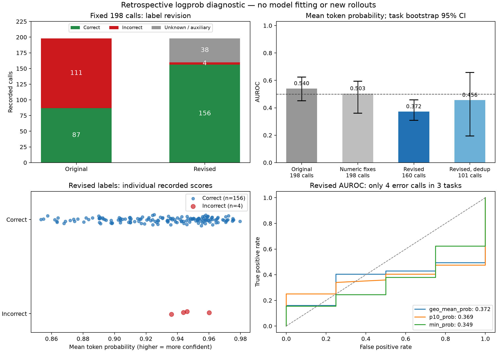

# 历史三元标签审计与 logprob 重新评估（已被二元 v2 替代）

> 本文保留 2026-10-15 的三元中间分析，用于解释标签口径如何演变；**当前研究采用二元标签，不再以本页的 4 个错误作为主要结论**。当前结果见 [二元标签修订与 logprob 评估](../legacy_binary_v2/二元标签与logprob评估.md)。本发布副本仅泛化来源路径、删除环境专用命令，并保留历史指标。

日期：2026-10-15。全部工作为 CPU 离线分析，模型请求 0 次，未启动 GPU。原始轨迹与其中的动作、返回、标签、logprob 和任务成功字段均保留。

**历史主结果：198 步修订为 156 个正确、4 个错误、38 个无法确定。** 可判定业务调用 160 个，平均 token 概率 AUROC 为 **0.3718**，按任务 bootstrap 95% 区间 [0.308, 0.458]。错误仅来自 3 个任务；这份小样本诊断不足以确认信号具有稳定判别能力，也不是新方法的独立留出成绩。

这些错误的平均分为 0.9465，正确步骤为 0.9297；按平均 token 概率选择最低分的 20% 调用，4 个已确认错误一个也没有覆盖。去掉重复语义尝试后，AUROC 为 0.4558，按任务重采样区间为 [0.195, 0.658]。这批记录未显示出可用的“低 logprob 定位错误”效果；不能据此推广为所有任务上 logprob 都无效。

## 1. 标签定义与审查边界

主标签判断“当前业务调用是否语义合理、参数是否有当时可见依据、必要依赖是否满足”。不把模拟器是否报错直接当标签，也不判断最终自然语言回答或整个任务成功。数值字段按 Decimal 比较，接受存储中的数字字符串；严格 JSON schema 是否通过另有字段。无论重试是否浪费资源，参数语义正确的调用仍标为局部正确。

所有规则与逐步理由在评分评估前生成并冻结为 `protocol.json` 与 `steps_revised.jsonl`，评估脚本核对哈希。自由文本与争议案例由 Codex 对照源码和上下文审查；**不是独立人工双标真值**。完整无分数上下文审查材料保存在历史研究档案中；本发布副本提供协议、标签摘要和指标。

## 2. 原标签如何变化

| 原标签 | 修订正确 | 修订错误 | 无法确定 |
| --- | ---: | ---: | ---: |
| 正确（87） | 78 | 0 | 9 |
| 错误（111） | 78 | 4 | 29 |

原负例转为正确的 78 次调用，包括 64 次数值表示误判、11 次有充分历史依据的正确求和、3 次地址末尾句号差异。这里是调用尝试数，包含重试。任务 l3-027 的参考公式为 `30 / 3`，但此前实际点赞数为 70、80、90，正确总数应为 240；该任务 6 次求和均修订为正确。

## 3. 可确认的错误与判定口径

| 类型 | 次数 | 任务 | 具体依据 |
| --- | ---: | --- | --- |
| 距离单位转换 | 2 | l3-016 第 5 步；l3-017 第 4 步 | 需求 1 km；API 单位米，传入 1，应为 1000 |
| 先决信息缺失 | 2 | l3-026 第 4、5 步 | 只获得点赞数 10、20，尚未查询最后一篇帖子的点赞数，就传入 10+20+30 |

两次提前求和的结果事后碰巧等于真实总数，主标签依据原系统提示“参数必须来自需求或此前输出”判为过程错误。它们是同一个缺信息状态下的两次尝试，去重后只算一个。下文另报“仅按最终数值答案”口径，不隐去这种区别。

## 4. 无法确定的 38 步

| 原因 | 次数 | 处理依据 |
| --- | ---: | --- |
| 会议 schema 冲突且地点缺失 | 9 | 旧 schema 将 attendees 暴露为 string，原 API 为 list(str)；地点未给出 |
| 任务 35 缺少旅行输入 | 10 | 出发地、目的地、日期均未提供，无法按隐藏 gold 评判 |
| 缺少退房日期/入住时长 | 5 | 所有相关调用同规则处理，包含原正例 |
| 工资周期未声明 | 6 | 用户要求月薪，但 API 没声明返回工资的年/月周期；除以 12 不能直接判错 |
| 经度符号冲突 | 3 | 模型把 Geocoding 的正经度改为负值；可见证据与地理语义有冲突，保守单列 |
| 湿度单位冲突 | 1 | API 文档为百分比，参考/历史为 0–1 小数 |
| 辅助工具检索 | 4 | 旧 mock 的语义标签不可靠，另保留实际是否返回工具文档 |

“无法确定”不等于正确，也不等于错误。会议调用确实不符合原 API 数组类型，但模型收到的是错误的 string schema；可在修复 schema 后的新实验中检验，不能将旧环境缺陷当成干净模型错误。任务 35 即使有个别日期格式不合法，也按预先固定的任务输入缺失规则整体单列，不按结果挑选排除。

## 5. logprob 指标

分数完全复用旧记录，不做重采样、阈值挑选、分数翻转或校准拟合。正确为正类，高分应更正确。本文“平均 token 概率”指原推理段概率的几何平均 `geo_mean_prob`。AUROC 随机基线为 0.5；错误 AUPRC 的随机基线为当前错误率。Brier/ECE 是把原始分数当正确概率时的描述性误差，不代表它已校准。

| 主分析信号 | AUROC | 错误 AUPRC | Brier | ECE（5 等宽箱） | 验证最低分 20% 时错误捕获率 |
| --- | ---: | ---: | ---: | ---: | ---: |
| geo_mean_prob | 0.3718 | 0.0238 | 0.0282 | 0.0449 | 0.0000 |
| p10_prob | 0.3694 | 0.0236 | 0.0820 | 0.2062 | 0.0000 |
| min_prob | 0.3494 | 0.0228 | 0.4004 | 0.6048 | 0.0000 |
| tail_geo_mean_prob | 0.3494 | 0.0244 | 0.0341 | 0.0679 | 0.0000 |
| frac_highprob | 0.3782 | 0.0240 | 0.0557 | 0.1541 | 0.0000 |

主分析错误 AUPRC 的随机基线为 4/160 = 0.0250；随机抽查 20% 调用的期望错误捕获率为 0.20。同分时按随机顺序的期望处理。这里只是错误定位模拟，尚未实施额外验证或纠错。

## 6. 标签、重试和历史的敏感性

| 分析口径 | 样本 | 正确 | 错误 | 错误任务数 | 平均 token 概率 AUROC |
| --- | ---: | ---: | ---: | ---: | ---: |
| original_all | 198 | 87 | 111 | 29 | 0.5401 |
| numeric_fix_only | 198 | 151 | 47 | 17 | 0.5032 |
| original_on_revised_subset | 160 | 78 | 82 | 25 | 0.5491 |
| revised_all | 160 | 156 | 4 | 3 | 0.3718 |
| revised_first_semantic_attempt | 101 | 98 | 3 | 3 | 0.4558 |
| revised_before_first_mock_error | 90 | 89 | 1 | 1 | 0.2360 |
| revised_calculator_answer_only | 160 | 158 | 2 | 2 | 0.4177 |

- `original_all`：旧标签，原始 198 步，包含辅助检索。仅复现历史统计。
- `numeric_fix_only`：只修复旧审计确认的 64 次数值表示假阴性，其他旧标签不变；诊断对照。
- `original_on_revised_subset`：与主分析相同的可判定业务调用，使用旧标签；控制样本集合变化。
- `revised_all`：主分析：修订后可判定的业务调用；保留所有重试。
- `revised_first_semantic_attempt`：去重：同任务、API、语义参数及相关成功返回相同，保留首次；不按分数或标签去重。
- `revised_before_first_mock_error`：历史敏感性：仅保留各任务首次 mock 报错之前及产生该次报错的调用。
- `revised_calculator_answer_only`：口径敏感性：两次提前计算仅看事后答案，改为正确；其余标签不变。

同一任务、API、语义参数和相关成功返回相同的重试只保留第一次；公式按计算结果规范化。缺少最后一个点赞数时的计算与查询齐全后的计算，相关证据不同，因此不会被错误地合并。“首次 mock 报错前”只说明没有此前模拟器错误反馈，仍有工具预解锁等原实验限制。

bootstrap 以任务为单位重采样 1000 次（默认），避免将同任务重试当独立样本。AUROC 无法计算的单类重采样会被跳过，JSON 记录有效次数；错误任务只有 3 个，区间仍不稳定。区间仅反映已观察任务的重采样，不能覆盖尚未出现的错误类型；尤其只有一个错误任务的子集，不应据其区间作稳健总体推断。

## 7. 同一 API 内的检查

| API | 正确 | 错误 | 平均 token 概率 AUROC |
| --- | ---: | ---: | ---: |
| Calculator | 13 | 2 | 0.4231 |
| NearbyRestaurants | 20 | 2 | 0.2000 |

其他 API 的可判定调用只有正例，不能计算其 AUROC。总体排序还可能受 API 类型和推理长度影响，同 API 内的检查也只有极少负例。

## 8. 可以得出的结论与下一步

旧的 111 个负标签并不等于 111 次真实参数错误；标签误判、信息不足和环境接口冲突占了大部分。该历史版本当时只确认两类问题：单位换算和缺少证据时提前计算。它们对应后续可尝试的简单特征是“单位一致性”和“所需数据是否已观察齐全”，此处尚未新增评分信号或训练校准器。

应结合 AUROC 区间、去重和答案口径敏感性理解本次分数，不能凭 4 个错误宣布 logprob 有效或无效。本次也不重算任务成功率、错误传播率或纠错收益：错误的模拟器反馈已经改变了后续轨迹，修订标签不能恢复未发生的执行。

## 9. 本次发布的历史材料

- [protocol.json](protocol.json)：该历史版本的三元口径及来源信息。
- [label_summary.json](label_summary.json)：标签数量、迁移和原因汇总。
- [logprob_metrics.json](logprob_metrics.json) / [CSV](logprob_metrics.csv)：历史指标、按任务区间和敏感性结果。
- [logprob_relabel_diagnostic.png](logprob_relabel_diagnostic.png)：标签迁移与分数诊断图。

数值分析不变。`protocol_sha256` 对应采用相对路径的公开协议副本，`archived_protocol_sha256` 保留原研究协议的哈希；其余代码、数据和标签哈希用于识别历史输入，不表示完整历史源码和中间轨迹都在本目录发布。本文不提供依赖未发布档案的重算命令，也不会覆盖当前二元结果。
