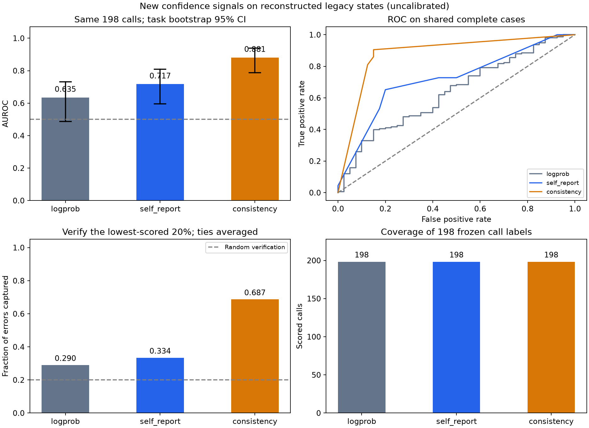

# 自陈置信度与多采样一致性：固定旧步骤的新信号试验

复用已清洗的二元标签和原工具调用，新增评分不执行工具、不推进任务。评估脚本只进行 CPU 离线统计；采集模型请求及耗时以采集协议为准。

冻结工具调用共 198 步；读入评分行 198 条。正确为正类，高分应更正确；缺失分数保留缺失，不填 0，也不拿前一步分数代替。

| 信号 | 覆盖/总数 | 正确/错误 | AUROC | 任务 bootstrap 95% CI |
| --- | ---: | ---: | ---: | --- |
| 原 logprob | 198/198 | 158/40 | 0.6351 | [0.487, 0.731] |
| 自陈置信度 | 198/198 | 158/40 | 0.7172 | [0.596, 0.809] |
| 多采样一致性 | 198/198 | 158/40 | 0.8812 | [0.788, 0.938] |

不同信号若覆盖不同，不应直接用上表的 AUROC 差作为提升证据。以下对比固定同一组步骤。

| 新信号与原 logprob 同样本比较 | 样本数 | 新信号 AUROC | logprob AUROC | AUROC 差 | 配对差 95% CI |
| --- | ---: | ---: | ---: | ---: | --- |
| 自陈置信度 | 198 | 0.7172 | 0.6351 | 0.0820 | [-0.054, 0.219] |
| 多采样一致性 | 198 | 0.8812 | 0.6351 | 0.2460 | [0.128, 0.374] |
| 严格一致性（次要） | 198 | 0.8222 | 0.6351 | 0.1871 | [0.064, 0.322] |

| 三信号均有值的共同样本 | 信号 | AUROC | 错误 AUPRC | 最低分 20% 错误捕获率 | Brier | ECE（5 等宽箱） |
| ---: | --- | ---: | ---: | ---: | ---: | ---: |
| 198 | 原 logprob | 0.6351 | 0.3418 | 0.2900 | 0.1733 | 0.1278 |
| 198 | 自陈置信度 | 0.7172 | 0.3632 | 0.3342 | 0.1531 | 0.1111 |
| 198 | 多采样一致性 | 0.8812 | 0.6285 | 0.6869 | 0.1235 | 0.1347 |

AUROC 随机基线为 0.5；随机抽查 20% 的期望错误捕获率为 0.20。同分跨过 20% 预算时按随机顺序的期望计算。Brier/ECE 只是把原始分数视作概率的诊断；一致性频率和自陈值都尚未拟合校准器，不能据此宣称已完成置信度校准。

| 正确组／固定错误原因 | 标签数 | 自陈覆盖 | 自陈均值 | 一致性覆盖 | 一致性均值 |
| --- | ---: | ---: | ---: | ---: | ---: |
| 正确组 | 158 | 158/158 | 0.8123 | 158/158 | 0.8586 |
| humidity_unit_not_resolved | 1 | 1/1 | 0.9500 | 1/1 | 0.0000 |
| search_no_result | 1 | 1/1 | 0.5000 | 1/1 | 0.0000 |
| fabricated_meeting_location | 9 | 9/9 | 0.7778 | 9/9 | 0.0000 |
| kilometers_not_converted_to_meters | 2 | 2/2 | 0.6500 | 2/2 | 0.0000 |
| calculation_before_all_counts_observed | 2 | 2/2 | 0.6500 | 2/2 | 0.0000 |
| fabricated_checkout_date | 5 | 5/5 | 0.9200 | 5/5 | 0.8000 |
| unverified_coordinate_sign_change | 3 | 3/3 | 0.7333 | 3/3 | 0.3333 |
| unsupported_salary_period_conversion | 6 | 6/6 | 0.3833 | 6/6 | 0.0000 |
| fabricated_travel_inputs | 10 | 10/10 | 0.5200 | 10/10 | 0.0667 |
| retrieval_capability_mismatch | 1 | 1/1 | 0.3000 | 1/1 | 0.0000 |

错误类型直接取冻结 revision.reason_code；均值仅使用各组已有分数，覆盖不足时不能当全组均值。这张表只描述不同错误上信号的表现；不据此改标签、挑阈值或替换主指标，各类型的 API 和任务构成不同也会影响均值。

| 去重敏感性：只留原标注的首次语义尝试 | 信号 | 覆盖/去重总数 | AUROC | 95% CI |
| --- | --- | ---: | ---: | --- |
| 原有 first_semantic_attempt 标志 | 原 logprob | 130/130 | 0.6980 | [0.543, 0.809] |
| 原有 first_semantic_attempt 标志 | 自陈置信度 | 130/130 | 0.8063 | [0.689, 0.892] |
| 原有 first_semantic_attempt 标志 | 多采样一致性 | 130/130 | 0.8793 | [0.782, 0.938] |

去重口径沿用冻结标签中的 first_semantic_attempt，包含任务、API、语义参数和相关前置证据；不依据新分数或标签挑选重试。JSON 同时保存去重后的配对和三信号共同样本结果。

| 历史敏感性：首次 mock 报错之前（含产生首次报错的调用） | 信号 | 覆盖/子集总数 | AUROC | 95% CI |
| --- | --- | ---: | ---: | --- |
| 原有 before_first_mock_error 标志 | 原 logprob | 100/100 | 0.6915 | [0.495, 0.890] |
| 原有 before_first_mock_error 标志 | 自陈置信度 | 100/100 | 0.7329 | [0.553, 0.905] |
| 原有 before_first_mock_error 标志 | 多采样一致性 | 100/100 | 0.8166 | [0.670, 0.961] |

该子集减少此前模拟器错误反馈对历史状态的影响，仍复用旧环境记录；不替代全部调用的主分析。

按任务聚类 bootstrap 1000 次，固定种子 20261015。重采样保留任务内的全部步骤和重复任务副本；单类重采样无法计算 AUROC，单独记为省略。AUROC 差与两条信号使用完全相同的任务副本，避免把独立区间相减当配对检验。

原轨迹没有保存完整逐步输入，新增信号来自重建状态：应称为“重建状态下的自评/一致性”，不等同于原生成当时的原生自陈置信度。当前动作的执行返回、隐藏答案和清洗标签不得用于生成这两个执行前信号。历史仍可能包含旧模拟器的错误反馈。

原 logprob 是旧动作生成时保存的 token 分数；自陈是针对既有候选动作另行询问，一致性是从重建前置状态重新提出后续动作。输入状态和探测任务均存在差异，配对 AUROC 比较仅比较这些操作性定义下的信号，不能把差异全部归因于信号机制本身。

本轮采样模式：**无思考采样策略与原动作的一致程度**。协议记录 consistency_thinking=`False`，self_report_thinking=`False`，K=`3`，temperature=`0.7`，top_p=`1.0`，max_tokens=`4096`。原 logprob 来自旧 thinking 策略产生的动作；本轮结果可诊断新增打分器的价值，不能声称复现了原始生成策略，或把 AUROC 差单独归因于一种置信度机制。

这是探索性筛选，复用的标签和任务已被审阅，没有独立留出集，也没有训练新的置信度模型。一致地重复同一个错误仍可能给高分；多个合理的后续动作可能拉低一致性。

一致性 K 分布（有分数步骤）：`{"3": 198}`。非法分数计数：`{}`。

主一致性是各独立样本与原候选调用在预定语义归一化下的匹配比例，不是样本内部的多数派占比。匹配要求相同 API 和语义参数：规范化数值、时间、安全算式、个人地址末尾句点；EmailReminder.content 是自由文本，主指标排除该字段，保留收件人、时间、地点等其余字段。严格一致性若提供则单独作为次要诊断，不据结果替换主信号。无工具调用属于有效的未匹配，截断另行报告；传输失败导致样本缺失时，整步一致性保持缺失，不能缩小分母。若响应含多个工具调用，沿用原运行器只取首个调用；严格一致性保留全部参数字段（包括自由文本），按 JSON 值比较并忽略对象键顺序。无工具调用或 length 截断且未解析出调用记为不一致。每步只有 3 次采样时，分数仅有 0、1/3、2/3、1 四档，适合初筛，精度和稳定性有限。

采集质量与成本单独统计，不影响上述样本、标签或信号分数：

- 已汇总 198 条步骤评分，成功取得采样 594 次；与原候选语义一致 424 次，严格一致 376 次。
- 逐步计数中，无工具调用 29 次（0.0488），length 截断 0 次（0.0000）；二者可重叠，不相加当作独立错误数。计数已知步骤中缺少采样 0 次。
- 公开采集摘要：成功请求 792 次，失败请求 0 次；独立采样 594 次，其中无工具调用 29 次、多个工具调用 8 次、截断 0 次。
- 已记录 usage 的响应 792 条：prompt tokens 621282，completion tokens 23729，total tokens 645011；另有 0 条成功响应缺 usage。

质量字段的逐步覆盖情况保存在 JSON。请求与 token 成本来自公开的 collection_summary.json，仅用于描述采集开销；未知计数保留未知。评估不读取运行时日志。



产物：`new_signal_metrics.json`（完整覆盖率/配对区间/去重）、`new_signal_metrics.csv`（各队列指标）、`joined_scores.csv`（逐步对应，不含新增标签）、`new_signal_comparison.png`。

在项目根目录运行以下评估命令，仅做 CPU 离线统计，不会自动启动模型或发起推理：

```bash
python code/evaluate_new_signals.py --labels outputs/legacy_binary_v2/calls_binary.jsonl --scores outputs/new_signals_fast_v1/scores.jsonl --out-dir outputs/new_signals_fast_v1 --bootstrap 1000 --seed 20261015
```

如需重新采集 fast 模式信号，须自行准备支持工具调用的模型服务。使用公开状态和新的输出目录，避免覆盖冻结结果。下面的采集命令会发起模型推理：

```bash
python code/collect_new_signals.py --states outputs/new_signals_fast_v1/states.jsonl --out-dir outputs/my_signals --endpoints http://localhost:8000/v1 --no-consistency-thinking --cooldown 1
```
