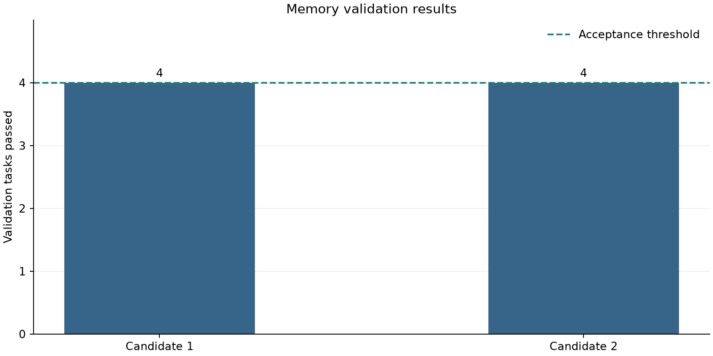

# ConfAgent 必填参数记忆实验

固定使用 Qwen3-8B，按基础任务隔离 10 个开发、4 个核验和 20 个测试实例。实例根据 API-Bank 工具定义构造。历史复核轨迹只参与经验构建。结果适用于这组受控新任务，评测范围为下一步动作。追问只计缺信息处理，工具模拟返回单独记录。

两组沿用同一 ReAct 基础提示、单步输出约定和检查预算（最多 1 次）。推理温度为 0.0，种子为 20261115，每个决策的输入与输出共用 4096 token 上限，记忆计入输入。

## 经验构建与核验

- 候选 1 的决策通过 4/4（validation-nyc-rental-length 通过、validation-harborlight-availability 通过、validation-travel-reminder-id 通过、validation-weather-current-position 通过）。核验时实际注入了 0/3 条规则。
- 候选 2 的决策通过 4/4（validation-nyc-rental-length 通过、validation-harborlight-availability 通过、validation-travel-reminder-id 通过、validation-weather-current-position 通过）。核验时实际注入了 0/3 条规则。

| 阶段 | 请求数 | 输入 token | 输出 token | 总 token |
| --- | ---: | ---: | ---: | ---: |
| 开发任务决策 | 10 | 5,747 | 3,493 | 9,240 |
| 开发自陈置信度 | 3 | 1,723 | 14 | 1,737 |
| 经验提炼 | 2 | 6,418 | 913 | 7,331 |
| 独立核验 | 8 | 4,320 | 1,338 | 5,658 |

经验构建失败。入库要求四个决策全部通过，且每条规则都曾实际注入。测试阶段未运行。

另记录 1 次请求异常，无服务端 token 用量。

