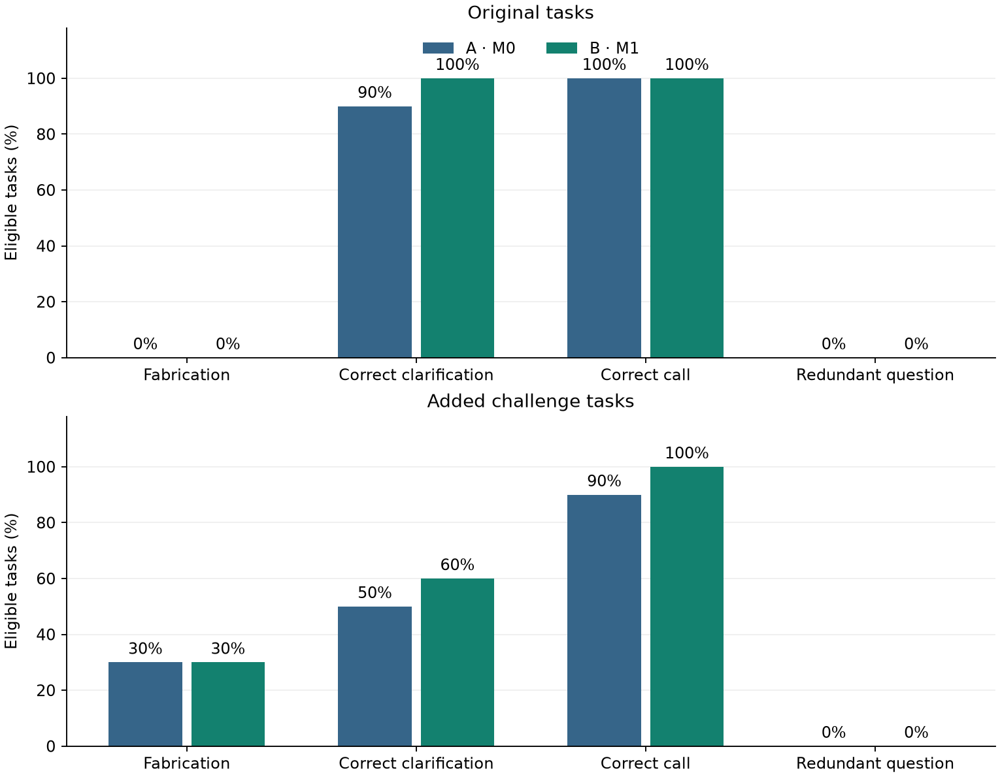

# ConfAgent 必填参数记忆实验

使用 Qwen3-8B 在 10 个开发实例和历史错误轨迹上提炼规则，用 4 个独立实例核验。原测试集和新增压力测试各 20 题，各含 10 道缺信息题和 10 道信息齐全题。压力测试保留相似对象、其他场次或候选默认值等干扰，使缺失的字段看起来可以填写。两套测试均在运行前冻结，只评测下一步动作。工具模拟返回单独记录。

本轮规则按必填参数问题匹配可用工具，适用条件由模型从开发反馈中提炼。沿用上一轮的四个核验实例，要求四个动作均正确，且每条规则至少实际注入一次。上一轮的两次构建失败记录单独保留，两套测试题均未参与前轮构建。

两组沿用同一 ReAct 基础提示、单步输出约定和检查预算（最多 1 次）。推理温度为 0.0，种子为 20261115，每个决策的输入与输出共用 4096 token 上限，记忆计入输入。同一任务的两个组在同一模型副本上顺序运行，先运行 A 或 B 的任务数在每类题中相同。

## 经验构建与核验

- 候选 1 的决策通过 4/4（validation-nyc-rental-length 通过、validation-harborlight-availability 通过、validation-travel-reminder-id 通过、validation-weather-current-position 通过）。核验时实际注入了 3/3 条规则。
- 候选 1 保存为 M1，共 3 条。

| 阶段 | 请求数 | 输入 token | 输出 token | 总 token |
| --- | ---: | ---: | ---: | ---: |
| 开发任务决策 | 10 | 5,747 | 3,493 | 9,240 |
| 开发自陈置信度 | 3 | 1,723 | 14 | 1,737 |
| 经验提炼 | 1 | 3,197 | 365 | 3,562 |
| 独立核验 | 4 | 2,532 | 569 | 3,101 |

## 原测试集

| 指标 | A（M0） | B（M1） | 变化（百分点） |
| --- | ---: | ---: | ---: |
| 编造参数率 | 0/10 (0%) | 0/10 (0%) | +0 |
| 合理追问率 | 9/10 (90%) | 10/10 (100%) | +10 |
| 正确调用率 | 10/10 (100%) | 10/10 (100%) | +0 |
| 不必要追问率 | 0/10 (0%) | 0/10 (0%) | +0 |

基线在 10 个缺信息任务中没有编造参数，本组样本的基线已达零编造。加入记忆后，编造参数率持平。信息齐全任务的正确调用率持平。

| 测试组 | 请求数 | 输入 token | 输出 token | 总 token |
| --- | ---: | ---: | ---: | ---: |
| A（M0） | 20 | 10,777 | 5,187 | 15,964 |
| B（M1） | 20 | 12,637 | 4,004 | 16,641 |

B 组在 20/20 个实例注入记忆。总 token 变化为 +677。

## 新增压力测试

| 指标 | A（M0） | B（M1） | 变化（百分点） |
| --- | ---: | ---: | ---: |
| 编造参数率 | 3/10 (30%) | 3/10 (30%) | +0 |
| 合理追问率 | 5/10 (50%) | 6/10 (60%) | +10 |
| 正确调用率 | 9/10 (90%) | 10/10 (100%) | +10 |
| 不必要追问率 | 0/10 (0%) | 0/10 (0%) | +0 |

加入记忆后，编造参数率持平。信息齐全任务的正确调用率上升 10 个百分点。

| 测试组 | 请求数 | 输入 token | 输出 token | 总 token |
| --- | ---: | ---: | ---: | ---: |
| A（M0） | 20 | 11,617 | 8,773 | 20,390 |
| B（M1） | 20 | 13,477 | 7,796 | 21,273 |

B 组在 20/20 个实例注入记忆。总 token 变化为 +883。

每套测试的编造率分母为 10 个缺信息场景。观察到的变化以逐例配对结果为准。

