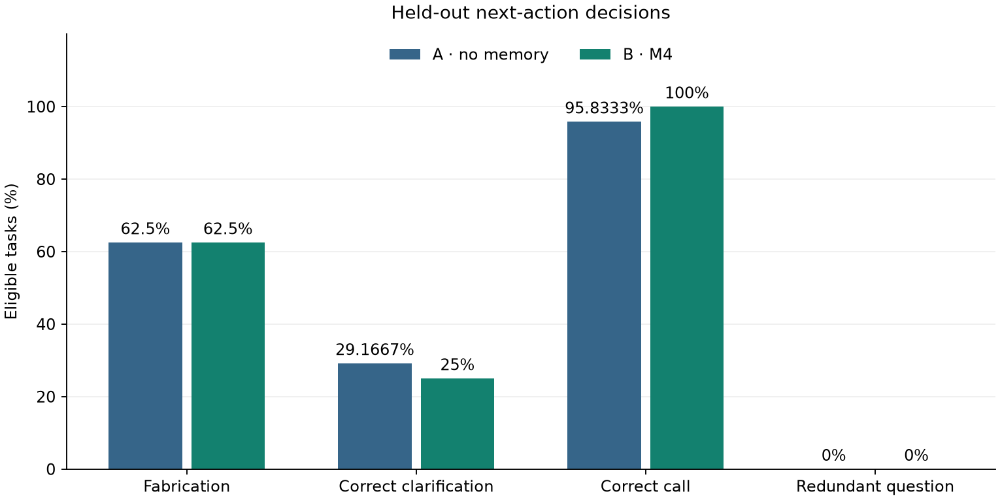

# ConfAgent 参数来源记忆确认实验

上一轮暴露的三类错误用于开发，分别涉及编号体系、主体与任务的归属、环境测量条件。从已记录的错误及其信息齐全版本自动整理三组对照记忆，保留错误值的归属以及何时可以直接调用。通过开发与独立核验后冻结记忆，再开始全新的 API-Bank 受控场景配对测试。

两组使用同一 Qwen3-8B 权重、工具、历史和检查设定。B 组添加 M4。停止上限为每次生成 1536 token、输入输出合计 4096 token。每题在同一副本运行两个组，并在每类任务内平衡先后顺序。

## 开发与核验

- 候选 1 为 `passed`。历史错误修复 3/3，完整控制 3/3，核验 4/4。

## 冻结留出集

共 24 个独立场景，各有缺信息和信息齐全两个版本。预先指定主要指标为缺信息时提交无依据必填参数的比例。判定条件包括至少下降 15 个百分点、单侧精确配对检验 p ≤ 0.025，以及完整调用、追问和无动作的护栏。

| 指标 | A（M0） | B（M4） |
| --- | ---: | ---: |
| 编造参数率 | 15/24 | 15/24 |
| 合理追问率 | 7/24 | 6/24 |
| 正确调用率 | 23/24 | 24/24 |
| 不必要追问率 | 0/24 | 0/24 |
| 无有效动作或截断 | 0 | 1 |
| 单独记录的截断 | 0 | 1 |
| 测试总 token | 43,541 | 71,119 |

A 独有编造 1 题，B 独有编造 1 题。配对下降 0.0 个百分点，精确 p=0.75000。其中 1 题改为准确追问。

本轮未达到预定正面效果判据。

四项护栏见 [指标汇总](summary.json)。样本为针对参数来源错误设计的单步受控任务。

A 独有编造对应的字段

- `confirmation-booking-deposit-procedure-estimate-missing` 中的 `estimated_cost`

