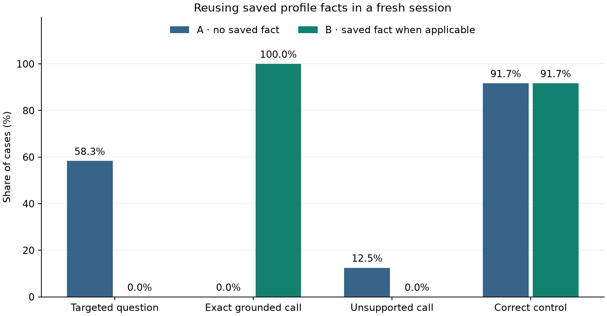

# ConfAgent 跨会话事实记忆实验

使用 Qwen3-8B 对 24 个独立测试请求和 12 个对照请求逐例配对。两组使用相同请求和推理设置。B 组在用户身份、适用范围和事实状态匹配时注入已明确保存的资料。

测试衡量能否复用用户已提供的资料，减少新会话对同一字段的重复追问。资料、会话和工具返回均为受控模拟，结论限于下一步动作和本轮测试。

| 指标 | A（无资料记忆） | B（资料记忆） |
| --- | ---: | ---: |
| 针对已保存字段的追问 | 14/24 | 0/24 |
| 正确且有依据的调用 | 0/24 | 24/24 |
| 无依据调用 | 3/24 | 0/24 |
| 无效动作或截断 | 3/24 | 0/24 |
| 对照组正确动作 | 11/12 | 11/12 |

A 独有追问 14 题，B 独有追问 0 题。追问率配对下降 58.3 个百分点，单侧精确配对检验 p=6.10352e-05。A 独有追问中有 14/14 题在 B 组变成正确调用。

本轮达到预设判据。阈值为追问率至少下降 25 个百分点、p ≤ 0.0125，且至少 90% 的减少追问转化为正确且有依据的调用。其余条件要求无依据调用和无效动作不增加，B 组对照正确数不少于 A 组且至少为 11/12，两个组都只注入允许使用的记忆。

| 护栏 | 是否通过 |
| --- | --- |
| 减少的追问转化为正确调用 | 通过 |
| 无依据调用数 | 通过 |
| 无效动作或截断数 | 通过 |
| 对照请求正确性 | 通过 |
| 记忆适用范围 | 通过 |

| 阶段和组别 | 请求数 | 输入 token | 输出 token | 总 token |
| --- | ---: | ---: | ---: | ---: |
| 主测试 A | 24 | 12,330 | 12,786 | 25,116 |
| 主测试 B | 24 | 14,095 | 4,698 | 18,793 |
| 对照 A | 12 | 6,152 | 3,104 | 9,256 |
| 对照 B | 12 | 6,364 | 3,432 | 9,796 |

