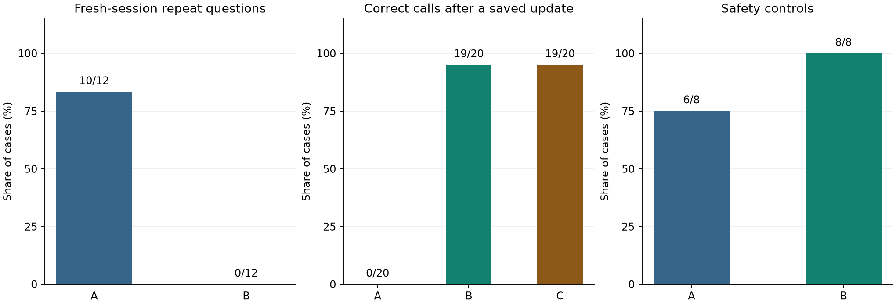

# ConfAgent 版本化事实记忆实验

使用 Qwen3-8B 评估三个受控分区。A 组没有跨会话事实记忆。B 组根据已知用户和事实槽位选取最新有效记录。更新分区另设 C 组，按时间顺序提供同一槽位的真实历史记录，并交由模型判断当前有效的值。

安全对照中，A 正确 6/8，B 正确 8/8。对照包含撤回、用户不匹配、槽位不匹配和当前轮覆盖历史值。

| 结果 | A（无记忆） | B（最新有效值） | C（历史重放） |
| --- | ---: | ---: | ---: |
| 复现组针对已保存字段的追问 | 10/12 | 0/12 | — |
| 更新组正确使用最新值 | 0/20 | 19/20 | 19/20 |
| 更新组使用无效版本 | 0 | 0 | 0 |

## 预设主要终点

- 复现组追问净减少 83.3 个百分点，单侧精确配对检验 p=0.000976562。9/10 个减少的追问改为正确调用。未达到该终点的预设判据。
- 更新组正确调用净增加 95.0 个百分点，单侧精确配对检验 p=1.90735e-06。未达到该终点的预设判据。

| 护栏 | 是否通过 |
| --- | --- |
| 安全对照正确性 | 通过 |
| 无依据调用数 | 通过 |
| 无效动作或截断数 | 未通过 |
| 无效版本调用 | 通过 |
| 观察记录适用范围 | 通过 |

## 历史重放与资源

在更新组中，B 与 C 的输入 token 差值为 -632，总 token 差值为 +1,042。B 在 11/20 个配对中开销更低。单侧配对符号检验 p=0.411901。在观测到的正确调用数和无效动作护栏下，未达到预设的次要效率判据。

| 分区与组别 | 请求数 | 输入 token | 输出 token | 总 token |
| --- | ---: | ---: | ---: | ---: |
| 复现 A | 12 | 6,452 | 4,524 | 10,976 |
| 复现 B | 12 | 7,223 | 5,442 | 12,665 |
| 更新 A | 20 | 10,702 | 8,812 | 19,514 |
| 更新 B | 20 | 11,976 | 8,932 | 20,908 |
| 更新 C | 20 | 12,608 | 7,258 | 19,866 |
| 安全对照 A | 8 | 4,215 | 2,764 | 6,979 |
| 安全对照 B | 8 | 4,340 | 2,659 | 6,999 |

结果适用于已知用户、已知事实槽位以及按规则保存的模拟事实。A 与 B 的更新组对比衡量能否使用已解析的版本化事实，B 与 C 的对比衡量预先解析记录与让模型读取时间线的表现。

