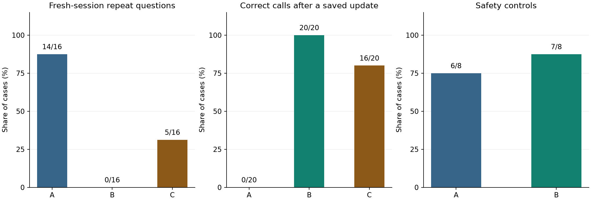

# ConfAgent 带来源依据的版本化记忆实验

所有组收到相同的当前请求和工具说明。A 无跨会话记忆。B 注入最新有效事实，并附上该事实与当前用户、所需资料的精确匹配说明，以及授权保存该事实的用户原话。C 注入同一个最新版的字段和值。三组共用模型、推理和证据边界设置。

安全对照共 8 件，A 正确 6/8，B 正确 7/8。对照覆盖撤回、用户不匹配、槽位不匹配和当前轮覆盖历史值。

| 分区和指标 | A 无记忆 | B 带来源依据 | C 仅字段和值 |
| --- | ---: | ---: | ---: |
| 复现组追问已保存的字段 | 14/16 | 0/16 | 5/16 |
| 复现组正确调用 | 0/16 | 16/16 | 11/16 |
| 更新组正确使用最新值 | 0/20 | 20/20 | 16/20 |
| 更新组使用无效版本 | 0/20 | 0/20 | 0/20 |

## 预设主要终点

两个 A/B 终点共用无依据调用、无效或截断动作、过期或越权值以及对照正确性护栏。各自的单侧精确配对检验门槛为 p ≤ 0.0015625。

- 复现组减少追问 87.5 个百分点，p=6.10352e-05。少追问的 14 件中，有 14 件变为正确调用。达到预设判据。
- 更新组正确调用增加 100.0 个百分点，p=9.53674e-07。达到预设判据。

| 护栏 | 是否通过 |
| --- | --- |
| 安全对照正确性 | 通过 |
| 无依据调用数 | 通过 |
| 无效动作或截断数 | 通过 |
| 无效版本调用 | 通过 |
| 观察记录适用范围 | 通过 |

## 来源关联记忆的探索性比较

合并两个留出分区，B 正确调用 36/36，C 正确调用 27/36。B 独有正确 9 件，C 独有正确 0 件，单侧精确配对检验 p=0.00195312。
B 在 36 个测试和 8 个对照中使用无效事实 0 次。C 在 36 个测试中使用无效事实 0 次。

| 分区与组别 | 请求数 | 输入 token | 输出 token | 总 token |
| --- | ---: | ---: | ---: | ---: |
| 复现 A | 16 | 10,141 | 7,388 | 17,529 |
| 复现 B | 16 | 12,139 | 3,636 | 15,775 |
| 复现 C | 16 | 11,185 | 7,359 | 18,544 |
| 更新 A | 20 | 13,439 | 9,646 | 23,085 |
| 更新 B | 20 | 15,961 | 6,447 | 22,408 |
| 更新 C | 20 | 14,744 | 11,296 | 26,040 |
| 安全对照 A | 8 | 4,999 | 4,456 | 9,455 |
| 安全对照 B | 8 | 5,224 | 3,875 | 9,099 |

结果适用于已知用户和槽位，以及已有明确授权的受控跨会话事实。评测范围为当前请求的下一步动作。

