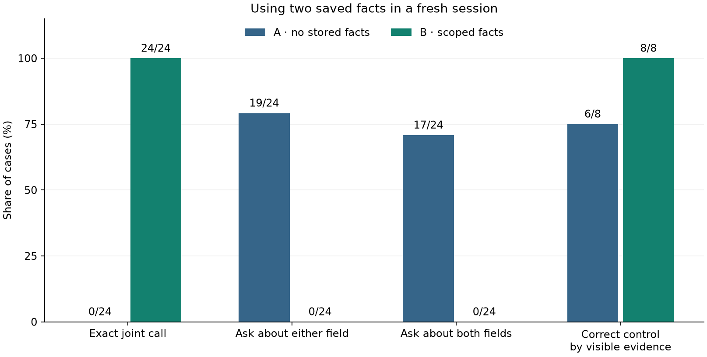

# ConfAgent 双字段跨会话事实记忆实验

任务要求同一次工具调用填写两个必填字段。两组使用相同的当前请求、工具和模型设置。B 按当前用户和两个资料槽位取回可用的最新有效事实，并提供匹配说明和先前的用户授权原话。

对照按每组当时能看到的信息评估。只有部分事实可用时，正确动作只询问仍缺的字段。当前轮提供新值时，新值覆盖旧值，并保留另一个仍有效的事实。

| 指标 | A 无记忆 | B 作用域内记忆 |
| --- | ---: | ---: |
| 两个必填值均有依据的正确调用 | 0/24 | 24/24 |
| 追问任一已保存字段 | 19/24 | 0/24 |
| 同时追问两个已保存字段 | 17/24 | 0/24 |
| 无依据调用 | 4/24 | 0/24 |
| 无效或截断动作 | 0/24 | 0/24 |
| 按可见证据判定的对照正确动作 | 6/8 | 8/8 |

主终点净增加 100.0 个百分点，B 独有正确 24 件，A 独有正确 0 件，单侧精确配对检验 p=5.96046e-08。
本轮达到预设判据。要求至少增加 50 个百分点、B 正确率至少 90%、p ≤ 0.0015625，且全部护栏通过。
A 独有的 19 件字段追问中，19 件在 B 转化为两个值均有依据的调用。

| 护栏 | 是否通过 |
| --- | --- |
| 无依据调用数 | 通过 |
| 无效或截断动作次数 | 通过 |
| 过期、撤回或不匹配的事实 | 通过 |
| 注入的记忆范围 | 通过 |
| 安全对照正确性 | 通过 |

| 对照条件 | A 正确 | B 正确 |
| --- | ---: | ---: |
| revoked | 1/2 | 2/2 |
| missing | 2/2 | 2/2 |
| wrong_profile | 1/1 | 1/1 |
| wrong_slot | 1/1 | 1/1 |
| current_update | 1/2 | 2/2 |

| 分区及组别 | 请求数 | 输入 token | 输出 token | 总 token |
| --- | ---: | ---: | ---: | ---: |
| 留出测试 A | 24 | 16,122 | 12,095 | 28,217 |
| 留出测试 B | 24 | 21,798 | 7,127 | 28,925 |
| 安全对照 A | 8 | 5,239 | 4,340 | 9,579 |
| 安全对照 B | 8 | 6,447 | 2,497 | 8,944 |

本轮评估有明确授权且用户身份和资料槽位已知的模拟记录。指标衡量新会话中的下一步动作。

