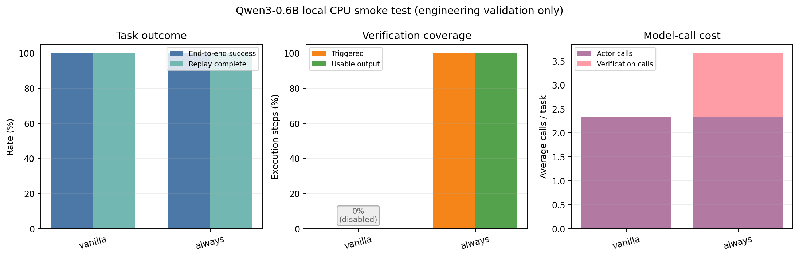

# 小模型流程烟测结果

> 本结果仅用于验证代码链路是否可运行，不代表正式模型能力或论文结论。

| 条件 | 任务数 | 最终成功率 | Replay完成率 | 验证触发率 | 可用验证/步骤 | 平均模型调用 | 平均验证调用 |
|---|---:|---:|---:|---:|---:|---:|---:|
| vanilla | 3 | 100.0% | 100.0% | 0.0% | 0.0% | 2.33 | 0.00 |
| always | 3 | 100.0% | 100.0% | 100.0% | 100.0% | 3.67 | 1.33 |

## 本次可观察结果

- 两个条件均为 3/3 端到端成功，说明本地模型、工具解析、mock 环境、轨迹和终止判断已连通。
- `always + critic` 覆盖 4/4 个执行步骤，4/4 均产生可用结构化验证结果。
- 4 个正确候选均被保留，未发生 `correct_to_error`；该简单烟测没有自然错误，因此不宣称纠错收益。
- 全量验证平均每任务增加 1.33 次模型调用，图中明确展示了可靠性检查的成本。

## 动作轨迹预览

| 条件 | 任务 | 工具动作 | 已验证/可用 | Replay | 最终成功 |
|---|---|---|---:|---:|---:|
| vanilla | l3-000 | GetWeather | 0/1 | True | True |
| vanilla | l3-001 | LookupUser → SendEmail | 0/2 | True | True |
| vanilla | l3-002 | ReserveRoom | 0/1 | True | True |
| always | l3-000 | GetWeather | 1/1 | True | True |
| always | l3-001 | LookupUser → SendEmail | 2/2 | True | True |
| always | l3-002 | ReserveRoom | 1/1 | True | True |

